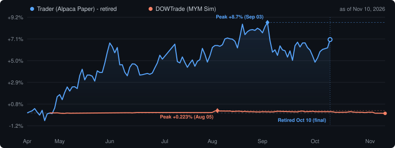

**English** · [繁體中文](README.zh-TW.md)

# Yu-I Juan — I find out why things break, then I write it down

Year 2 Electrical Engineering at [Hanze University of Applied Sciences](https://www.hanze.nl/), Groningen 🇳🇱.
Taiwanese. I build embedded hardware and small self-hosted systems, and the part I like most is
the fault that does not make sense yet.

| | |
|---|---|
| **Looking for** | An internship in test, verification or measurement, July 2027 – January 2028, in the Netherlands or Taiwan |
| **Good at** | Fault isolation on real hardware, embedded firmware (ESP32 / ESP8266), KiCad boards from schematic to bring-up, Linux on single-board computers |
| **Certificates** | **VOL-VCA** (Dutch supervisor-level safety) · APCS · IELTS 7.0 / C1 |
| **Languages** | Mandarin (native) · English (C1) · German (A2) |
| **Path** | 🇹🇼 Taiwan → 🇩🇪 exchange year in Germany '21–'22 → 🇳🇱 Netherlands |

## How I work

```
 symptom ──> measure ──> kill a hypothesis ──> root cause ──> write-up
                 ^               |                               |
                 └── next one ───┘              open items stay marked open
```

Every repo below follows this loop. When I was wrong, the write-up says where.

## Start here: four fault investigations

| Repo | Symptom | What the measurement showed | Result |
|---|---|---|---|
| [rpi4-usb-ssd-resilience](https://github.com/Hydr0neFN/rpi4-usb-ssd-resilience) | A Pi 4 crashed when the desk was bumped. The logs were empty. | The journal lived on the disk that dropped, so the evidence died with it. Four separate faults, one obvious. | Automatic recovery in 22 seconds. The proof run found three more bugs. |
| [basil-growbox](https://github.com/Hydr0neFN/basil-growbox) | An ESP8266 reset several times an hour while ping answered in 1–2 ms. | Ping is answered below the sketch, so "it responds" proved nothing. Three explanations failed, one of them at 3.29 V measured on the 3V3 rail. | Trigger found: 0 crashes in 23 hours, 3 in 3 minutes with a second API client. The mechanism is still open, and the README says so. |
| [ili9341-dead-quarter](https://github.com/Hydr0neFN/ili9341-dead-quarter) | A quarter of a 2.8" display never updates. Every on-screen self-test says **PASS**. | The test reads back the region that it drew. Two builds from one source file on one board isolate the build configuration. | One build is broken, one is correct, same source. |
| [hinet-dual-path-probe](https://github.com/Hydr0neFN/hinet-dual-path-probe) | Does a static IP lower game ping? | Two ISP account types on one line, measured at the same time on the UDP path a Source 2 game uses. | Median ping is identical. The tail is not: 1 sample in 6 above 60 ms on the dynamic account, 1 in 868 on the fixed one. Data updates hourly. |

## Hardware and firmware

| Project | What it is | My part |
|---|---|---|
| [smart-pet-door](https://github.com/Hydr0neFN/smart-pet-door) | ThermaPaw: a sealed, motor-driven pet door that cuts HVAC loss. ESP32-C6, TMC2130 stepper, LD2410 radar, ToF. | Year 1 capstone, team lead. Demonstrated live with a real dog. |
| [LightController](https://github.com/Hydr0neFN/LightController) | USB-C PD LED controller PCB V2. CH224K PD sink, AP63205 buck, ESP32-C3. | Schematic, layout, fabrication and bring-up in KiCad. |
| [ReactionTimeDuel](https://github.com/Hydr0neFN/ReactionTimeDuel) | Four-player reaction game over ESP-NOW with wireless joysticks. | Selected for the Hanze Open Day. |
| [wholeTest](https://github.com/Hydr0neFN/wholeTest) | Hardware integration tests for ReactionTimeDuel: display, host MCU and joystick links, before the full build. | Each part is validated alone first. |
| [Duco](https://github.com/Hydr0neFN/Duco) | 868 MHz reverse engineering of a ventilation unit with ESP8266 + CC1101. | Captured the traffic, stopped at rotating keys in the join handshake. Shelved. The negative result is the useful part. |
| [CAMtest](https://github.com/Hydr0neFN/CAMtest) | Two ESP32-CAMs for stereo vision that aims a spotlight. | Shelved: too fragile in real conditions. |
| [lightbar2mqtt](https://github.com/Hydr0neFN/lightbar2mqtt) | ESP32 / ESP32-C3 bridge from a Xiaomi monitor light bar to Home Assistant. | Fork: added BME280 + SCD41 sensors, a PlatformIO build, OTA, and reliability fixes from weeks of use. |

## Home and desk

Home Assistant and UniFi on two sites in two countries, self-hosted with Docker on single-board computers.

| Project | What it is |
|---|---|
| [NLDeskCYD](https://github.com/Hydr0neFN/NLDeskCYD) · [PCDeskCYD](https://github.com/Hydr0neFN/PCDeskCYD) | ESP32 touchscreen dashboards for Home Assistant, LVGL 9 + PlatformIO |
| [CO2](https://github.com/Hydr0neFN/CO2) · [Kitchen](https://github.com/Hydr0neFN/Kitchen) | CO₂ desk lamp (SCD41, BME280) and an LD2410B presence radar, linked over ESP-NOW, in HomeKit |
| [JonsPanel](https://github.com/Hydr0neFN/JonsPanel) | Native replacement for the JONSBO PC Monitor app; drives USB HID case panels with less CPU and memory |
| [mousecal](https://github.com/Hydr0neFN/mousecal) | Measure and correct the rotation angle of a mouse sensor, in the browser |
| [id4-tray](https://github.com/Hydr0neFN/id4-tray) | Windows tray app for the Audient iD4 MKII: sample rate and ASIO buffer size |
| [tourplan](https://github.com/Hydr0neFN/tourplan) · [tripcompanion-app](https://github.com/Hydr0neFN/tripcompanion-app) | Self-hosted trip tools: a date picker for the least technical relative, and a phone-first trip timeline |
| [denba-app](https://github.com/Hydr0neFN/denba-app) | iPad-first PWA for inventory, sales, trials and P&L |
| [yt-subtitle-translator](https://github.com/Hydr0neFN/yt-subtitle-translator) | Real-time YouTube subtitle translator (DeepL + Google) |
| [room-presence](https://github.com/Hydr0neFN/room-presence) | Which zone of the room a person is in, from WiFi CSI and BLE phone RSSI on ESP32 anchors, fused in Home Assistant. Measurements and open limits included |
| [powermon](https://github.com/Hydr0neFN/powermon) | ESP8266 firmware that counts electricity-meter pulses with a photodiode and publishes watts and kWh over MQTT |
| [mpv-adaptive-enhance](https://github.com/Hydr0neFN/mpv-adaptive-enhance) | mpv setup for Windows that picks, per video, the best picture the GPU can sustain: shaders and frame interpolation |

## AI tooling, with checks

I use language models as debaters, executors and reviewers, with a check between each step.
The harness around the model is the interesting part.

| Project | What it does |
|---|---|
| [claude-bridges](https://github.com/Hydr0neFN/claude-bridges) | MCP bridges that let one agent consult other models for structured, role-based review |
| [solver-verified-bench](https://github.com/Hydr0neFN/solver-verified-bench) | LLM benchmark where answer keys are data, timeouts count as failures, and the limits are written down |
| [claude-memory-web](https://github.com/Hydr0neFN/claude-memory-web) | Browser UI for a self-hosted memory store: no build step, ETag conflict diffs, git history |
| [trader](https://github.com/Hydr0neFN/trader) · retired 2026-10-10 | Paper-trading bot: a multi-model pipeline behind hard-coded Python safety rails. +7.06% against SPY +12.68% over 6 months, alpha t=0.35. Retired, with the write-up in the repo. |
| [DOWTrade](https://github.com/Hydr0neFN/DOWTrade) | The same idea on futures, measured against a deterministic control arm. Still running; live numbers below. |

## Tools I use

**Embedded** · `ESP32` `ESP8266` `Arduino` `PlatformIO` `ESPHome` `KiCad` `LVGL` `RF 868MHz` `ESP-NOW` `MQTT`
**Software** · `C/C++` `Python` `JavaScript` `C#` `Flask` `FastAPI` `Docker` `HomeKit`
**Design and infrastructure** · `Fusion 360` `3D Printing` `Home Assistant` `UniFi` `Cloudflare` `Raspberry Pi`

## 📊 Appendix — live telemetry

DOWTrade publishes its own numbers below; trader is retired and shown at its final
snapshot. A cron job on the Pi rewrites this block on a schedule, so it shows whatever the
last run produced.

<!-- LIVE_STATS:START -->
> **Live Stats** · updated 2026-11-13 17:15 ET · *auto-generated by RPi cron*
>
> | | Trader (Alpaca Paper)<br>Retired 2026-10-10 — final | DOWTrade (MYM Sim) |
> |---|---|---|
> | Equity | $107,064.60 | $999,262.32 |
> | Return | +7.06% (SPY +12.68%) | -2.95% |
> | Net P&L | — | $-737.68 |
> | Positions | 24 (frozen, not liquidated) | FLAT |
> | Day P&L | — | — |
> | Total Trades | — | 142 |
>
> DOWTrade returns are quoted against $25,000 of risk capital, not the sim account's $1M broker fallback — the strategy risks $250 a trade, so a percentage of a million is meaningless.
> Control arm: identical 15m bars, identical 2xATR stop and sizing, with the LLM ensemble replaced by a plain EMA(9/21) cross -> **$-3,759.65 over 275 trades** (26.2% win rate, -0.035R avg). Re-pricing the LLM version under the **same cost model** (one tick of adverse slippage per fill plus commission) gives **$-1,262.68 over 148 round trips**. The Net P&L row above is as-booked and predates that cost model, which applies to positions opened from 2026-09-09.
> Neither sample is remotely large enough to be significant. This is a direction, not a result.



<!-- LIVE_STATS:END -->

---

*Nearly all of it self-hosted on a single-board computer — because why pay for cloud when a $35 machine will do.*
