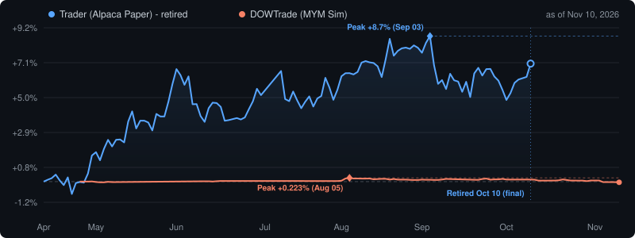

[English](README.md) · **繁體中文**

# Yu-I Juan — 東西壞了，我會查到底，然後寫下來

荷蘭 Groningen [Hanze 應用科學大學](https://www.hanze.nl/)電機工程二年級 🇳🇱，台灣人。
平常做嵌入式硬體和自架的小系統，最喜歡的是那種「這沒道理啊」的故障。

| | |
|---|---|
| **正在找** | 測試、驗證或量測方面的實習，2027 年 7 月到 2028 年 1 月，荷蘭或台灣都可以 |
| **拿手的事** | 在實體硬體上抓故障、嵌入式韌體（ESP32 / ESP8266）、KiCad 從電路圖畫到 bring-up、單板電腦上的 Linux |
| **證照** | **VOL-VCA**（荷蘭主管級安全證照）· APCS · IELTS 7.0 / C1 |
| **語言** | 中文（母語）· 英文（C1）· 德文（A2） |
| **經歷** | 🇹🇼 台灣 → 🇩🇪 德國交換一年 '21–'22 → 🇳🇱 荷蘭 |

## 我怎麼做事

```
 symptom ──> measure ──> kill a hypothesis ──> root cause ──> write-up
                 ^               |                               |
                 └── next one ───┘              open items stay marked open
```

症狀 → 量測 → 推翻一個假設 → 找到根因 → 寫成紀錄；還沒查清楚的地方就標成未解。
下面每個 repo 都照這個流程走。我自己判斷錯的地方，紀錄裡也會寫出來。

## 先看這四個：故障調查

| Repo | 症狀 | 量出來的結果 | 結論 |
|---|---|---|---|
| [rpi4-usb-ssd-resilience](https://github.com/Hydr0neFN/rpi4-usb-ssd-resilience) | 桌子一被撞到，Pi 4 就當機，log 裡卻什麼都沒有。 | journal 就存在那顆會斷線的硬碟上，硬碟一掉，證據跟著消失。總共四個問題，只有一個一眼看得出來。 | 現在 22 秒內自動復原。驗證時又抓到三個 bug。 |
| [basil-growbox](https://github.com/Hydr0neFN/basil-growbox) | ESP8266 一小時重開好幾次，ping 卻一直在 1–2 ms 內回應。 | 回 ping 的是底層網路堆疊，跟主程式無關，所以「ping 得到」什麼都不能證明。三個推論被推翻，其中一個是量到 3V3 電源軌有 3.29 V 才排除的。 | 觸發條件找到了：23 小時 0 次當機，第二個 API client 一連上，3 分鐘內 3 次。機制還沒查清，README 也照實寫。 |
| [ili9341-dead-quarter](https://github.com/Hydr0neFN/ili9341-dead-quarter) | 2.8 吋螢幕有四分之一永遠不更新，螢幕上的自我測試卻全部 **PASS**。 | 測試讀回的就是它自己剛畫的那一塊。同一塊板子、同一份原始碼編出兩個 build，問題就鎖定在 build 設定上。 | 一個 build 壞、一個正常，原始碼完全相同。 |
| [hinet-dual-path-probe](https://github.com/Hydr0neFN/hinet-dual-path-probe) | 固定 IP 真的能降低遊戲 ping 嗎？ | 同一條線路上的兩種帳號同時量，走的是 Source 2 遊戲實際使用的 UDP 路徑。 | ping 中位數完全相同，差別在尾端：浮動 IP 每 6 筆有 1 筆超過 60 ms，固定 IP 是每 868 筆 1 筆。資料每小時更新。 |

## 硬體與韌體

| 專案 | 內容 | 我負責的部分 |
|---|---|---|
| [smart-pet-door](https://github.com/Hydr0neFN/smart-pet-door) | ThermaPaw：有氣密、用馬達開關的寵物門，減少冷暖氣流失。ESP32-C6、TMC2130 步進馬達、LD2410 雷達、ToF。 | 大一 Capstone，擔任組長。現場展示時請了真的狗來走。 |
| [LightController](https://github.com/Hydr0neFN/LightController) | USB-C PD LED 控制器 PCB V2。CH224K PD sink、AP63205 buck、ESP32-C3。 | 用 KiCad 畫電路圖、layout，送廠打樣，再 bring-up。 |
| [ReactionTimeDuel](https://github.com/Hydr0neFN/ReactionTimeDuel) | 四人反應速度對戰遊戲，用 ESP-NOW 連無線搖桿。 | 入選 Hanze Open Day 展出。 |
| [wholeTest](https://github.com/Hydr0neFN/wholeTest) | ReactionTimeDuel 的硬體整合測試：螢幕、主控 MCU、搖桿連線，組裝前先測。 | 每個部分先單獨驗過。 |
| [Duco](https://github.com/Hydr0neFN/Duco) | 用 ESP8266 + CC1101 逆向一台通風主機的 868 MHz 訊號。 | 訊號有錄到，卡在加入程序的輪替金鑰，最後收掉。留著是因為「做不到」這個結果本身有用。 |
| [CAMtest](https://github.com/Hydr0neFN/CAMtest) | 兩顆 ESP32-CAM 做立體視覺，用來瞄準聚光燈。 | 已擱置：放到實際環境裡太不穩定。 |
| [lightbar2mqtt](https://github.com/Hydr0neFN/lightbar2mqtt) | 把小米螢幕掛燈接上 Home Assistant 的 ESP32 / ESP32-C3 橋接器。 | Fork：加了 BME280 + SCD41 感測器、PlatformIO build、OTA，還有連跑幾週後修掉的穩定性問題。 |

## 家裡和桌上

兩個國家、兩個據點的 Home Assistant 和 UniFi，都用 Docker 自架在單板電腦上。

| 專案 | 內容 |
|---|---|
| [NLDeskCYD](https://github.com/Hydr0neFN/NLDeskCYD) · [PCDeskCYD](https://github.com/Hydr0neFN/PCDeskCYD) | 接 Home Assistant 的 ESP32 觸控面板，LVGL 9 + PlatformIO |
| [CO2](https://github.com/Hydr0neFN/CO2) · [Kitchen](https://github.com/Hydr0neFN/Kitchen) | CO₂ 檯燈（SCD41、BME280）和 LD2410B 人體雷達，用 ESP-NOW 互連，接進 HomeKit |
| [JonsPanel](https://github.com/Hydr0neFN/JonsPanel) | 取代 JONSBO PC Monitor 的原生程式；驅動 USB HID 機殼螢幕，更省 CPU 和記憶體 |
| [mousecal](https://github.com/Hydr0neFN/mousecal) | 在瀏覽器裡量出滑鼠感測器的旋轉角度並修正 |
| [id4-tray](https://github.com/Hydr0neFN/id4-tray) | Audient iD4 MKII 的 Windows 系統匣工具：切取樣率和 ASIO buffer 大小 |
| [tourplan](https://github.com/Hydr0neFN/tourplan) · [tripcompanion-app](https://github.com/Hydr0neFN/tripcompanion-app) | 自架的出遊工具：給最不熟 3C 的親戚也會用的挑日子工具，和手機優先的行程時間軸 |
| [denba-app](https://github.com/Hydr0neFN/denba-app) | iPad 優先的 PWA：進銷存、試用和損益 |
| [yt-subtitle-translator](https://github.com/Hydr0neFN/yt-subtitle-translator) | YouTube 字幕即時翻譯（DeepL + Google） |

## AI 工具，每一步都有檢查

我讓語言模型分別當辯論的、動手的和審查的，每一步之間都卡一道檢查。
有意思的是模型外面那層 harness。

| 專案 | 功能 |
|---|---|
| [claude-bridges](https://github.com/Hydr0neFN/claude-bridges) | MCP 橋接：讓一個 agent 找其他模型，照固定格式、分角色來做審查 |
| [solver-verified-bench](https://github.com/Hydr0neFN/solver-verified-bench) | LLM 基準測試：標準答案也當資料來管，逾時就算失敗，限制也都寫明 |
| [claude-memory-web](https://github.com/Hydr0neFN/claude-memory-web) | 自架記憶庫的瀏覽器介面：免 build、ETag 衝突 diff、git 歷史 |
| [trader](https://github.com/Hydr0neFN/trader) · 2026-10-10 退役 | 模擬交易機器人：多模型流程外面包一層寫死的 Python 安全護欄。6 個月 +7.06%，同期 SPY +12.68%，alpha t=0.35。已退役，檢討寫在 repo 裡。 |
| [DOWTrade](https://github.com/Hydr0neFN/DOWTrade) | 同樣的做法用在期貨上，另外跑一組純規則（不靠模型）的對照組來比。還在跑，即時數字在下面。 |

## 常用工具

**嵌入式** · `ESP32` `ESP8266` `Arduino` `PlatformIO` `ESPHome` `KiCad` `LVGL` `RF 868MHz` `ESP-NOW` `MQTT`
**軟體** · `C/C++` `Python` `JavaScript` `C#` `Flask` `FastAPI` `Docker` `HomeKit`
**設計與基礎設施** · `Fusion 360` `3D Printing` `Home Assistant` `UniFi` `Cloudflare` `Raspberry Pi`

## 📊 附錄 —— 即時遙測

DOWTrade 會在下方發布自己的運作數字；trader 已退役，顯示的是其最終快照。
Pi 上的 cron job 會定期改寫此區塊，因此呈現的內容永遠是最新一次執行的結果。

<!-- LIVE_STATS:START -->
> **即時數據** · 更新於 2026-11-13 17:15 ET · *由 RPi cron 自動產生*
>
> | | Trader (Alpaca 模擬)<br>已於 2026-10-10 退役（最終） | DOWTrade (MYM 模擬) |
> |---|---|---|
> | 淨值 | $107,064.60 | $999,262.32 |
> | 報酬率 | +7.06%（SPY +12.68%） | -2.95% |
> | 淨損益 | — | $-737.68 |
> | 持倉 | 24（已凍結，未平倉） | 空倉 |
> | 當日損益 | — | — |
> | 總交易次數 | — | 142 |
>
> DOWTrade 報酬率以 $25,000 風險資本計算，而非模擬帳戶的 $1M 券商預設值 — 每筆風險預算僅 $250，對一百萬報價沒有意義。
> 對照組：同一批 15m bar、同樣的 2×ATR 停損與部位大小，只把 LLM 決策換成 EMA(9/21) 交叉 → **$-3,759.65 / 275 筆**（勝率 26.2%，平均 -0.035R）。把 LLM 版本用**同一套成本模型**重算（每筆一跳逆向滑價 + 手續費）為 **$-1,262.68 / 148 筆**。上表的淨損益是歷史帳載值，未含成本模型 — 成本模型自 2026-09-09 起才對新倉位生效。
> 兩邊樣本都遠不足以達到統計顯著；這是方向，不是結論。



<!-- LIVE_STATS:END -->

---

*幾乎全部自託管於一台單板電腦 — 有一台 $35 的機器能跑，幹嘛付雲端的錢。*
